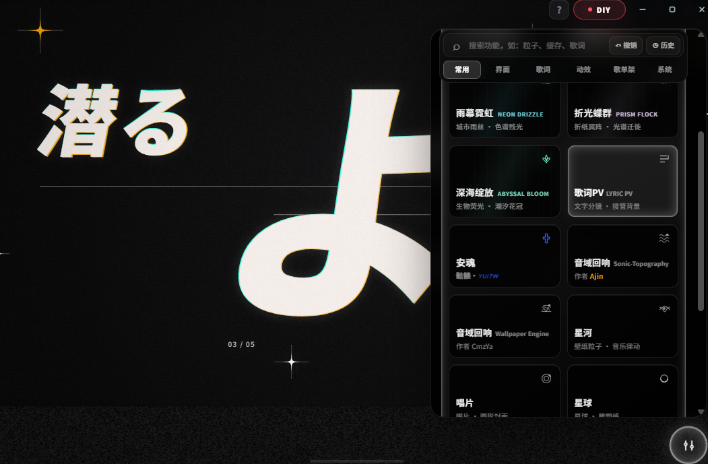

# Mineradio


Mineradio 是一款 Windows 桌面沉浸式音乐播放器，把搜索播放、歌词舞台、粒子视觉、3D 歌单架和完整桌面模式组合成一个更接近现场感的私人音乐空间。

## 立即下载 Windows 安装包

> 本仓库是 Mineradio 的**非官方 fork 构建**，与原作者的发布渠道无关。安装包发布在本仓库的 Releases；上游项目见 [XxHuberrr/Mineradio](https://github.com/XxHuberrr/Mineradio)。

| 下载入口 | 说明 | 链接 |
| --- | --- | --- |
| GitHub Releases（本仓库） | 安装包、版本说明与随附源码 | [查看 Releases](https://github.com/2128cz/Mineradio/releases) |
| 本仓库源码 | 与安装包同版本的完整源码（GPL-3.0 要求随二进制提供） | [2128cz/Mineradio](https://github.com/2128cz/Mineradio) |

安装时只需要下载并运行 `Mineradio-2.2.0-Setup.exe`。同一 Release 还应包含 `.blockmap`、`latest.yml` 与源码压缩包，这些是更新与合规所需的附带文件；不要把 `.blockmap`、`latest.yml` 或 `win-unpacked` 目录当成正式安装包。

本 fork 在上游 2.2.0 的基础上加入：歌词 PV 模式（视觉预设 13，含 21:9 / 16:9 / 4:3 / 1:1 / 4:5 / 3:4 / 9:16 画幅跟随、超宽屏模糊铺边、分镜预热）、视觉控制台里的 PV 参数组（含“重新生成当前歌”）、以及一组窗口与后台行为修复。完整差异见提交历史。

## 下载或安装被拦截怎么办

小众 Electron 桌面软件、未签名安装包有时会被浏览器、Windows Defender 或 SmartScreen 提示风险。请先确认安装包来自本仓库的 Releases 页面，文件名是 `Mineradio-2.2.0-Setup.exe`。

1. 浏览器下载栏提示风险时，打开下载列表，点这条下载右侧的 `...` 三个点，选择 `保留` / `仍要保留` / `显示更多` 后继续保留。
2. Windows SmartScreen 弹出蓝色拦截窗口时，点 `更多信息`，再点 `仍要运行`。
3. 如果杀毒软件明确显示木马、高危或已经隔离，不要强行运行；删除该文件后重新从本仓库 Releases 下载，仍然异常请带截图提交到本仓库 Issues。

## 当前版本

当前版本：`2.2.0`（本 fork 的构建标记：`v2.2.0-pv.2`）

状态：基于上游 2.2.0 的 fork 构建，含歌词 PV 模式与视觉控制台的 PV 参数组。

> 安全提示：本仓库只对自己 Releases 里的安装包负责。上游 `v1.0.10` 及更早版本的旧安装包与本 fork 无关，也不建议继续安装或传播。请使用本仓库 Releases 提供的 `Mineradio-2.2.0-Setup.exe`。

## 核心特性

- 首页包含每日推荐、平台推荐、继续听、听歌画像和我的歌单入口
- 完整桌面模式保留播放器、主页、歌单和桌面交互
- 支持本地 MP4 与 Wallpaper Engine 视觉内容
- 播放后切换到 Emily / 默认播放态视觉，歌词舞台与粒子舞台同步工作
- 基于节奏的电影镜头视觉系统
- 面向长播客和 DJ 曲目的专属视觉模式
- 歌词舞台、自定义歌词、歌词位置与视觉控制
- 自定义专辑封面上传与裁剪
- 右键唤起 3D 歌单架，支持歌单队列浏览
- 网易云音乐账号、搜索、歌单、播客等体验接入
- QQ 音乐搜索、登录态与音源补充接入
- GitHub Releases 更新检测与下载入口
- 首次启动内置「默认测试」视觉用户存档，软件内默认视觉参数与该存档一致
- 歌词 PV 模式：把当前歌曲的歌词编译成分镜档案，播放时在背景层实时绘制（视觉预设 13）

## 歌词 PV 模式

视觉控制台里选择 **歌词PV**，播放一首有歌词的歌，背景就会变成按歌词排布的「文字分镜」：每一句词都有对应的镜头、版式与出入场，随播放进度推进。切回任何其他预设即刻恢复原来的视觉，桌面歌词不受影响（它有自己的通路，不归这个模式管）。



几点说明：

- **先有档案才画**：播放到某首歌时，它的分镜档案会提前算好并落到本地缓存（播放列表里后几首在播放期间会顺带准备好），播放时只读档案出帧，所以切歌不会卡。
- **引擎体积**：第一次选中该预设时才加载 PV 引擎（约 2MB，本地文件、不需要联网），不选它就不会加载。
- **内存**：离开该预设时会释放出帧用的绘制器与画布。
- 无歌词或只有占位歌词的曲目不会生成档案，背景下保持原样。
- **画幅跟窗口形状走**：规划时按当前视口在引擎支持的画幅里取最接近的一档（21:9 / 16:9 / 4:3 / 1:1 / 4:5 / 3:4 / 9:16），播放时画面按等比放大铺满窗口、多出的部分由画面边缘自然裁掉（单边最多约 6.7%），所以不会留下黑边。窗口比例跨档后下一首歌会按新画幅重新规划一次（档案键含画幅，旧档自动不命中）；当前正在播的这首歌若与新形状差得超过 15%，会退回等比完整显示并留对称黑边。
- PV 引擎移植自开源项目 [JIZURA](https://github.com/852wa/JIZURA)（作者 hakoniwa，MIT 授权），其许可证原文随包附在 `vendor/jizura/LICENSE.txt`；移植范围与相对上游的唯一差异见 `docs/THIRD_PARTY_PORTS.md` 与 `NOTICE.md`。

## 使用说明

Windows 用户从本仓库 Releases 下载安装包。

正式分发以 Release 里的 `Mineradio-2.2.0-Setup.exe` 为准，不建议直接使用 `win-unpacked` 目录。安装包会创建桌面快捷方式。

已经安装过旧版本的用户可直接运行新的安装包完成更新。软件内更新入口只会打开浏览器下载页，不会在客户端内下载或应用补丁。

## 开发运行

```bash
npm install
npm start
npm run build:win
```

桌面版入口由 Electron 主进程加载本地服务。`npm run build:win` 会生成 Windows NSIS 安装包，产物位于 `dist/`。

## 更新机制

Mineradio 会请求 GitHub Releases latest 检测新版本，本 fork 指向本仓库（`2128cz/Mineradio`）的 Releases。远端版本高于本地版本时，应用内更新入口会展示 Release 内容，并通过系统浏览器打开下载页；即使 Release 附带完整安装包，`2.0.3+` 客户端也不会读取、下载、缓存或应用该附件与补丁。

本地验证更新链路时，可以通过 `MINERADIO_UPDATE_MANIFEST` 指向一个本地 manifest JSON 或 HTTP 地址来模拟线上 Release。

## 第三方音乐平台说明

Mineradio 不是网易云音乐、QQ 音乐或腾讯音乐娱乐集团的官方客户端，也不隶属于任何音乐平台。

项目中的第三方平台接入仅用于个人学习、本地客户端体验和用户自有账号的播放辅助。请遵守对应平台的用户协议、版权规则和会员权益规则。项目不会提供绕过付费、绕过会员、破解音质或重新分发音乐内容的能力。

## 用户数据与隐私

登录 Cookie、搜索历史、自定义封面、自定义歌词、节奏分析缓存等数据只应保存在本机用户数据目录或浏览器本地存储中，不应提交到仓库。

更多说明见 [PRIVACY.md](./PRIVACY.md)。

## 致谢与来源

本仓库是 [XxHuberrr/Mineradio](https://github.com/XxHuberrr/Mineradio) 的**非官方 fork**。以下致谢属于上游项目，在此保留：

- Mineradio 由 XxHuberrr 主要设计与打造。emily 作为早期视觉底层想法与 `emily` 视觉预设改进方向的共创者和灵感来源之一，特此感谢。
- 同时感谢小天才e宝、应春日、锋将军、軌跡、林中、骊、风痕、花椰菜🥦在早期体验、测试反馈和发布准备中的帮助。
- 歌词 PV 引擎来自 [JIZURA](https://github.com/852wa/JIZURA)（作者 hakoniwa，MIT），移植说明见 `NOTICE.md` 与 `docs/THIRD_PARTY_PORTS.md`。

## 版权与授权

上游 Mineradio：Copyright (C) 2026 XxHuberrr.
本 fork 的修改同样以 **GPL-3.0** 发布，详见 [LICENSE](./LICENSE)。

因此，分发本仓库构建的安装包时，必须同时提供**与该二进制完全对应的源码**（发布同一 tag 的本仓库即可），允许任何人再分发与修改，不能附加“禁止商用”“禁止再分发”等额外限制，并保留上游版权声明与许可证文本。

MR Logo、Mineradio 名称与上游原创视觉表达的版权归上游作者；GPL-3.0 不授予名称或商标的使用许可。本仓库是非官方 fork，不代表上游作者。
