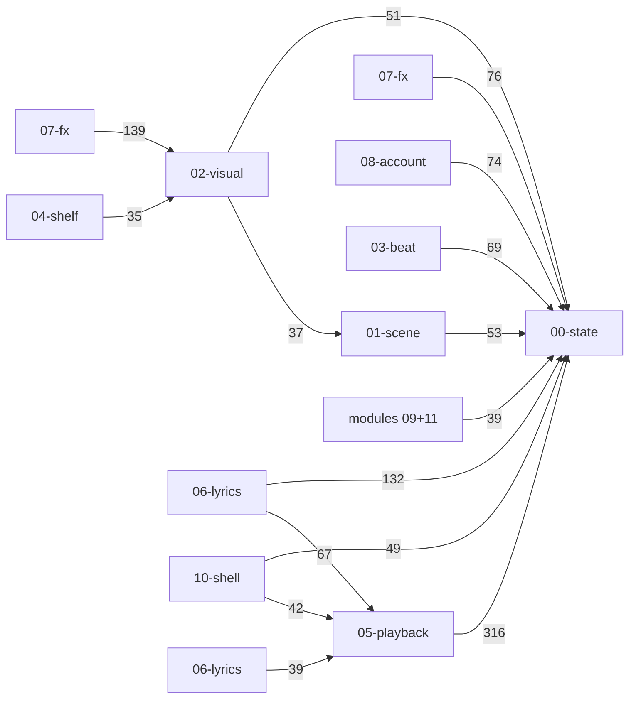

# Mineradio 项目大纲（实施依据）

本文件是**实施依据**，不是宣传页。任何改动本仓库的工作，先在此登记意图与实测证据，再动代码。
配套细则：`docs/PLAN_JIZURA_PV.md`（文字 PV 集成计划）。

## 0. 维护规则（留痕约定）

1. **先实测，后写结论**。每条断言要么带 `file:line`，要么显式标 `[未复核]` / `[待实测]`。
2. 每完成一段工作，在 §14 变更留痕追加一行：日期 / 做了什么 / **证据形式**（命令+读数、门 rc、截图路径）。
3. 量化结论必须可由脚本重跑再生（见 §4 的 `scripts/dev-module-graph.js`）。手抄的数字会过期，能重跑的不会。
4. 文档与产生它的代码改动进**同一个提交**。
5. 本节规则本身要遵守：不要用"大概""应该"填空。
6. **清单类内容不手抄**。新增控件 / 视觉预设 / 播放源，必须在同一提交更新 §11（功能清单）或 §12（新东西放哪），并让 `node scripts/dev-feature-index.js --check` 退出码为 0。手抄的清单会漂移，能从代码算出来的不会。

## 1. 进程模型（已实测）

```
Electron main  desktop/main.js (6058 行)
  ├ findOpenPort(3000)                      main.js:548      EADDRINUSE/EACCES → port+1
  ├ configureLocalServerEnvironment(port)   main.js:5017     注入 HOST/PORT + 全部数据路径
  ├ delete require.cache → require('../server.js')  main.js:5249-5250   ← 同进程，不是子进程
  └ loadURL('http://127.0.0.1:${port}/?startupAttempt=N')  main.js:5525
        ↓
      server.js (6717 行)  原生 http，无 express；102 个平铺 if (pn === ...) 在 4635-6700
        ↓ require（无 child_process）
      kugou-api / qishui-api / qq-vip-api / spotify-api / dj-analyzer / qishui-auth-v6 / cuefield
```

- 前端 ~200 处相对 `fetch('/api/...')` 同源打 server.js；本机能力走 ~78 个 `ipcMain.handle`（`desktop/preload.js:106`）。
- `server.js` **没有 `require.main` 守卫**：被 require 即开始监听。
- 开发实例与打包版**共用 `%APPDATA%\Mineradio`**（`main.js:103` 的 APP_NAME 回落到 `productName`，正式包装在 `G:\Mineradio`）⇒ 共用单实例锁（`main.js:501`）。`[待实测]` 未实机验证两者同时启动的行为。

## 2. 目录职责

| 目录 | 内容 |
|---|---|
| 根 `*-api.js` + `dj-analyzer.js` | 平台适配层，5 个单体 CommonJS 文件 |
| `public/` | 唯一应用页 + `js/modules/**` 115 个前端模块（`git ls-files` 计数）+ 18576 行单文件 CSS |
| `desktop/` | Electron 主进程与桌面模式/壁纸/本地库运行时（15 文件） |
| `cuefield/` | AutoMix 过渡规划器（GPLv3 移植，纯 Node，19 文件） |
| `build/` | 图标 + 1056 行 `installer.nsh`（路径安全核心）+ `after-pack.js` |
| `scripts/` | `quick-check.js`(5699 行) + Wallpaper Engine 实机探针 + 本大纲配套工具 |
| `tests/` | 53 文件，`node:test` 与自执行 assert 混用，**无 npm test**，入口是 quick-check |
| `qishui-auth-v6/` | 上游字节 passport 安全运行时原样留存 |

## 3. 开发闭环

| 动作 | 做法 | 依据 |
|---|---|---|
| 启动依赖 | `npm install`，若 `node_modules/electron/dist` 为空再 `ELECTRON_MIRROR=https://registry.npmmirror.com/-/binary/electron/ node node_modules/electron/install.js` | 本机解析到的 electron@42.4.1 无 `scripts` 字段 ⇒ npm 不取二进制；直连 GitHub 时 `@electron/get` 静默挂死 |
| 改代码后重启 | 桌面快捷方式 **Mineradio Dev** → `dev-restart.bat` → `scripts/dev-restart.ps1` | 按可执行路径精确杀本仓库 electron，不碰 `G:\Mineradio\Mineradio.exe` |
| 改 `public/**` | **不用重启**，窗口内 Ctrl+R（无打包器、`asar:false`、磁盘直读） | `index-loader.js:113-126` |
| 改 `server.js`/`desktop/`/`cuefield/`/`*-api.js` | **必须重启** | server.js 是主进程内 require |
| 验证起来了 | 脚本自证：`startup-state.json` 的 `phase=ready` + `startedAt ≥ 本次启动` + 回读 `GET /api/app/version` | `dev-restart.ps1` 末段，rc 0/2/3/4 |

## 4. `public/js/modules` 分层依赖图

### 4.1 加载方式（这是理解一切的钥匙）

`public/js/index-loader.js` 持 **116 条 `modulePaths`**（`const modulePaths = [` 起，`node scripts/dev-feature-index.js` 计数），用**同步 XHR** 逐个读，拼接后注入**单个 `<script>`**（`sourceURL=mineradio-index-modules.js`）。后果：

- **没有模块边界**：所有顶层 `const/let/var/function` 都是同一个全局作用域的兄弟，**列表顺序就是依赖顺序**。
- 因此"前向引用"不会炸，只因为引用点都在函数体内、真正执行时声明早已跑完。
- 缓存失效靠 `?v=Date.now()`。

### 4.2 规模（脚本产出，勿手抄）

重跑方式：`node scripts/dev-feature-index.js`（loader 条数与缺失）与 `node scripts/dev-module-graph.js`（唯一顶层声明、层间依赖、承重全局名）。**下面这张表是 2026-10-18 的快照**，只用来读趋势；当前值以脚本为准。

快照：105 模块 / 0 缺失 / **3623 个唯一顶层声明**；当前 loader 为 116 条 / 0 缺失。

| 层 | 模块 | 行数 | 顶层声明 |
|---|---|---|---|
| `00-state` | 12 | 2211 | 467 |
| `01-scene` | 5 | 2387 | 155 |
| `02-visual` | 16 | 12208 | 703 |
| `public-root`（两个 sonic preset） | 2 | 1901 | 0（IIFE 包裹） |
| `03-beat` | 7 | 3630 | 119 |
| `04-shelf` | 7 | 2722 | 50 |
| `05-playback` | 22 | 13220 | 794 |
| `06-lyrics` | 8 | 3757 | 259 |
| `07-fx` | 11 | 8661 | 505 |
| `08-account` | 7 | 4003 | 218 |
| `modules`（`09-idle-toast-libraries` + `11-main-loop`） | 2 | 1512 | 86 |
| `10-shell` | 6 | 3793 | 267 |

两个巨头：`05-playback`(22 模块/1.32 万行)、`02-visual`(16/1.22 万行)。

### 4.3 层间依赖（权重＝被跨层读取的唯一全局名数）



完整 50 条边（权重≥10）在 `tmp/layer-graph.mmd`。

### 4.4 结论：数字前缀是命名，不是架构

- **45 对层是双向引用**（`00-state ↔ 05-playback`、`02-visual ↔ 07-fx`、`06-lyrics ↔ 05-playback`、`01-scene ↔ 02-visual` ……）。12 层近乎两两互指。
- **386 处前向引用**：读取方在加载序里早于声明方。gap 最大的一批集中在 `00-state`/`01-scene` 读 `11-main-loop.js`（gap≈96）和读 `10-shell`（gap≈100）。

实践含义：**不要假设"我在第 N 层，就只能用第 <N 层的东西"**。真正要防的是"在模块顶层（函数体外）求值一个后面才声明的名字" —— 那才会 TDZ/undefined。写新模块时把副作用都收进函数、由 `10-shell/05-startup-bindings.js` 在启动时统一调用，就与现有代码同构。

### 4.5 承重全局名（改这些＝改半个前端）

| 名字 | 声明于 | 被多少个其它模块读取 |
|---|---|---|
| `showToast` | `09-idle-toast-libraries.js`（加载序 **97**） | **49** |
| `source` | `00-state/00-core-stores.js:6` | 41 |
| `clampRange` | `02-visual/04-visual-settings-persistence.js` | 39 |
| `audio` | `00-state/00-core-stores.js:6` | 35 |
| `currentIdx` / `playQueue` / `playing` | `00-core-stores.js:21-24` 同行多声明 | 33 / 29 / 19 |
| `playlist` / `mid` | `00-core-stores.js:22 / :14` | 26 / 26 |
| `camera` | `01-scene/00-renderer-quality.js:4` | 26 |
| `uniforms` | `02-visual/00-pointer-cover-particles.js` | 23 |
| `shelfManager` | `04-shelf/00-layout-hover.js` | 22 |
| `stageLyrics` | `02-visual/02-lyrics-state-layout.js` | 19 |

`showToast` 是最典型的反例：**半个代码库调它，而它声明在倒数第九个文件**。

### 4.6 本节目的的限制（诚实条目）

`scripts/dev-module-graph.js` 的"全局名"= **行首无缩进**的 `var/let/const/function/class` 声明（含同行 `var a=1,b=2` 多声明，已修；修复前少报 90 个）。**不解构**（`const {a,b} =` 会漏），不处理缩进的顶层声明。因此本表是**下界**：只漏不误报，用于评估影响面是安全的，不能当完备清单。重跑：`node scripts/dev-module-graph.js` → `tmp/module-graph.txt` + `tmp/module-table.md` + `tmp/layer-graph.mmd` + `tmp/load-bearing-globals.md`。

## 5. 逐层拆解

> 锚点来源：4 路深读 + 本文件作者的抽查复核。**已复核**的锚点在正文标注；未标注的属代理报告原文，使用前请自行 `grep` 一次（它们大多是行号，成本极低）。

### 00-state（12 模块 / 2211 行 / 467 声明）—— 全局态唯一入口
- `00-core-stores.js` 一行一个域：`:6` `audio/audioCtx/source/...`，`:14` `bass/mid/treble/audioEnergy`，`:21` `lyricsLines/lyricsTranslationLines`，`:22` `playlist/playQueue/currentIdx/playing/playToggleBusy`，`:24` `loginStatus`，`:57` `trackSwitchToken`，`:72` `userPlaylists/builtInPlaylists/各平台列表`，`:102-105` `visualPresetSchema='skull-preset-v2' / MAX_VISUAL_PRESET_INDEX=12 / SONIC_PRESET_INDEX=7 / SONIC_WORKSHOP_PRESET_INDEX=8`（**已复核**，且被 `tests/curated-visual-presets.test.js:17-19` 逐条钉死）。
- 坑：`playMode` **不在** `07-ui-playback-runtime.js`，而在 `01-perf-render-state.js:24` 的一条 `var` 多声明尾巴上（`var queueViewTab = ..., playMode = 'l...'`）。按文件名猜归属会猜错。
- 状态层会**反向调用上层**：`08-desktop-render-power.js` 读 `renderPerfState / getAdaptiveRenderFps / mainFrameGates`（声明在最后一个文件 `11-main-loop.js`）。

### 01-scene（5 / 2387）—— 场景、相机、画质
- `00-renderer-quality.js:2` `scene = new THREE.Scene()`（**唯一根，无分层 Group**）、`:4` PerspectiveCamera(45°)、`:177` `WebGLRenderer({antialias:false, alpha:true, powerPreference:'high-performance'})`、`:186` 挂 `#canvas-container`。**已复核**。
- 像素预算 `:5-7` DPR≤1.35 / `RENDER_PIXEL_BUDGET=5200000` / ≥0.72；`:126-133` 画质档；`:170-176` `getRenderLoadTier()` 0/1/2。
- 相机是**双轨叠加**：`01-orbit-free-camera.js:2-27` 分离 `user*` 与 `cine*` 球坐标 + `focus` 槽（`'shelf-side' | 'shelf-stage' | 'queue'`，:15-20 注释）+ `BASE_FOV=45`；`02-beat-camera-runtime.js:8-33` `thetaKick/phiKick/radiusKick/rollKick`；`03-focus-cinema-camera.js:34` `updateCamera()` 自由→回正→电影叠加。

### 02-visual（16 / 12208）—— 粒子 + 歌词的全部绘制
- 粒子 `00-pointer-cover-particles.js`：`:228-256` 几何（`position`+自定义 `aUv`+`aRand`）、`:325-370` **46 个 uniform**、`:376-977` 顶点着色器、**九路 `if (uPreset < n.5)` 在 VS 内换形态**（`:654 else if (uPreset < 8.5)`、`:823 else` **已复核**）、`:1010-1017` 主 Points + `bloomVs = vs.replace(...)`（**字符串替换生成 bloom 变体**）、`:1057` 背景星河 1400 点复用主 uniforms 引用。
- 骷髅 `01-float-skull-backcover.js`：`:121 SKULL_PRESET_INDEX=6`（已复核）、`:228` `fetch('assets/skull-decimation-points.bin')` → 校验 `byteLength%20===0` → 每点 5 float 拆 3 个 attribute。
- 歌词 16 文件链路见 §6。
- `04-visual-settings-persistence.js` 是**持久化枢纽**：`clampRange` 等 39 个读取方的归一化函数住这里。

### 03-beat（7 / 3630）—— 节拍分析与 beatmap 缓存
`00-tempo-worker-cache-prefetch.js`（music-tempo worker + 磁盘缓存预取）、`01-audio-beat-analysis.js`、`02-podcast-dj-analysis.js`、`04-beat-map-runtime.js`（`tickBeatMap`/`beatMapNextIdx`）、`06-sonic-audio-monitor.js`（8 带精细频谱快照）。

**两条识别路径与范围（2026-10-27 实测，见 `tests/beat-tempo-ceiling.test.js`）**
- **离线地图**：`music-tempo` worker 传 `minBeatInterval 0.22 / maxBeatInterval 1.2`（50–273 BPM）→ `normalizeMusicTempoBeats(times, duration, tempo)` 只去掉重复触发（按 tracker 自己锁定的间距，不再按 0.44 s 抽稀）→ `medianGap(…, 0.22, 1.20)` 得 `gridStep`；离线网格合成窗口同为 `0.22..1.20`。`tempoSource === 'music-tempo'` 的地图会**锁死**实时检测（`04-beat-map-runtime.js` 的 `gridTimingLocked`），并按歌缓存到磁盘（`/api/beatmap/cache`；`packLocalBeatMap` 的 `v` 是分析版本，旧版本读出来直接作废重算）。
- **实时检测**：`processRealtimeBeatEngine`（`01-scene/02-beat-camera-runtime.js:392`）从 analyser 五带算 onset/flux；tempo 锁范围 `0.24..0.88 s`，间隔 < 0.24 s 才折半，命中最小间隔 0.22 s；相机在地图侧的步伐 `min(0.5, max(0.22, step*0.86))` 跟歌走。
- **视觉消费**：相机冲击 ← `currentBeatMap.cameraBeats`（+ 实时合并）；背景脉冲 `beatPulse` ← `pulseBeats`；环 ← `sonicAudioMonitorState.frame`（8 带）+ `cameraBeats` + `gridStep`；PV 预设 13 **不吃节拍**（走档案计划）；舞台/桌面歌词只吃 `beatPulse`。
- **已知旧上限（已修）**：worker 0.36（166.7 BPM）与抽稀 0.44（143 BPM）曾让 150–160 BPM 变成精确半速、167+ 变成不精确半速（180 BPM 图上是 0.670 s，每拍差 1%）。修后实测 70→70.0/0.860 s、100→100.0/0.600 s、150→150.0/0.400 s、180→180.1/0.330 s。

### 04-shelf（7 / 2722，仅 50 个顶层声明）—— 3D 歌单架
工厂闭包 `makeShelfManager()`，实例挂 `shelfManager`。声明少 ⇒ 这层几乎不向外暴露全局，**接口面最干净**。几何/层级规则见 §7。

### 05-playback（22 / 13220）—— 最大的两层之一
见 §7 播放链路。`00-api-quality-output.js` 是**所有 `fetch` 的归口**（`apiJson` + AbortController + 音质档 + 输出设备）。

### 06-lyrics（8 / 3757）—— 歌词抓取解析 + 歌单面板 + seek
命名有历史包袱：目录叫 lyrics，实际装着 `01-playlist-panel-shell.js`/`02-playlist-detail.js`/`03-podcast-playlist-loaders.js`。见 §6/§7。

### 07-fx（11 / 8661）—— 设置面板、预设存档、Wallpaper Engine 库
`00-preset-archive-data.js` 管存档/短码（MR2），`04-preset-grid-uniforms.js` 管滑块→uniform，`03-wallpaper-engine-library.js`(2425 行) 管第三方画面。见 §8 配方。

### 08-account（7 / 4003）—— 五平台登录态
`02-login-status.js` 是状态汇总；**关键判定**：拒绝"能播即会员"（`applyQQPlaybackStatusEvidence` 恒 false，酷狗仅在 `membershipVerified` 且来源白名单才写入）。

### 09 / 11（2 / 1512）—— toast 与主循环
`09-idle-toast-libraries.js` 提供被 49 个模块读取的 `showToast`；`11-main-loop.js`(704 行) 是**唯一的 `renderer.render()` 调用点**（`:692`）与所有分帧闸门的调度处。

### 10-shell（6 / 3793）—— 手势、启动绑定、桌面覆盖
`05-startup-bindings.js` 是"把所有 bind* 跑起来"的总装；`04-desktop-overlay-fullscreen.js`(1640 行) 管桌面歌词覆盖层与全屏。

## 6. 歌词链路（数据流）

```
平台 LRC/YRC ──HTTP──> 06-lyrics/00-lyrics-fetch-parse.js
   lyricEndpointForSong:16-37 按 provider 选 /api/{,qq/,kugou/,qishui/}lyric
   readPersistentLyricCache:47 先查磁盘缓存（IPC）
   parseLyricText:396-426  LRC 正则；多标签行间有正文→每段各自成行
   finalizeLyricLineDurations:385-395  用下一行差值推 duration，夹 0.45..12s
   parseYrcText:599-633  逐字 words[{t,d,c0,c1}]
   attachLyricTranslations:508-598  译文配对：①最近时间(容差随句长 0.55~2.4s) ②比例回退
        ↓ setOriginalLyricsState → applyPreferredLyricsForCurrent → 写全局 lyricsLines(00-core:21)
        ↓ renderLyrics:634  —— 只失效 payload + 排预热，不直接绘制
14-stage-lyrics-rendering.js  每帧
   tickLyricsParticles:3083  总调度（换行/payload 选择/预热）
   stageLyricPlaybackSeconds:1515 = audio.currentTime + 每歌偏移(06-lyrics/06:84-88, ±5s/0.1s)
   findStageLyricIndexAtTime:3014-3031  二分，目标 t+0.05 预滚
   getLyricLineProgress:2620-2647  逐字→映射像素测量比例；逐行→smoothstep
   buildStageLyricDisplayPayload:2938 → 09-lyrics-payloads.js:34 归一
   10-lyrics-mask-textures.js:330 makeLyricMask  文字→CanvasTexture，产出 textMin/textMax
   12-lyrics-row-layers.js:413 建行 / :1324 每帧写 uniform（11-lyrics-shaders.js:64 定义语义）
        ↓
   uniforms: uProgress uFeather uActiveMix uSolar uSweep uGlitch* uBase/Hi/Glow/SolarColor
桌面歌词分叉：10-shell/04:1045 desktopLyricsPayload → :1364 pushDesktopLyricsState
   → IPC mineradio-desktop-lyrics-update → main.js:4905 → 覆盖窗(3745 建窗) → desktop-lyrics.html:739 applyState
```
**关键机制**："逐字 vs 逐行"**不是两套几何**，行网格永远逐行；逐字是 shader 内 `uv.x` 与 `uProgress` 比较（`11:116-119`），来源由 `timingSource==='yrc-word'` 决定。
**改外观必动的 8 处**（`00-lyrics-fetch-parse` 的 parse/translate、`tickLyricsParticles`、`getLyricLineProgress`+`findStageLyricIndexAtTime`、`buildStageLyricDisplayPayload`、`makeLyricMask`+建行、`makeLyricShaderMaterial`+`updateLyricRowLayers`、`desktopLyricsPayload`+`pushDesktopLyricsState`）—— 最后一对是陷阱：**新增字段若不进 `:1375` 的 31 字段 key，改动永远不会被推送**。

## 7. 播放与歌单链路

**起播**（`13-playback-start-audio.js`）：`playQueueAt:986` → 换源事务闸门 `beginSourceFallbackPlaybackInvocation:988` → `currentIdx=idx:1018` + **`trackSwitchToken++:1019`**（不 bump 则上一首的 await 不会失效）→ 取消旧曲（`resetCuefieldAutoMix:1023`/`pauseCurrentAudioForTrackSwitch:1080`）→ 按 provider 取链（qq:1176 / kugou:1178 / qishui:1190 / netease:1197）→ **一律走代理** `proxyAudioUrl='/api/audio?url=':1263`（服务端 `server.js:6640-6695` Range 透传，汽水 `#auth=` 先解密）→ `resetPlaybackAudioGraphForSourceSwitch:1292` → 绑事件 → 赋 `src:1316` + 身份标记 `__mineradioQueueItemKey/__mineradioTrackSwitchToken:1317-1318` → `playAudio:1405`。
**音频图**（`08:107 initAudio`）：优先 `createMediaElementSource`，抛错则永久标记并**换元素**；仍失败退 `captureStream()`（该分支没有 gainNode）。链路 `source→analyser(+beatAnalyser)→gainNode→destination`。
**换源事务**（`11-provider-fallback.js`）：`ensureSourceFallbackRecovery:362` 带 20s deadline、`queueAdvances≤2`、`providerAttempts≤4`、visited 去重；暂写队列→失败 `restoreSourceFallbackQueueItem:517` 回滚→终态 `settleSourceFallbackTerminal:531`。
**AutoMix**：B deck 是**第二个 `<audio>` + 第二个 MediaElementSource**（`18:501/401-412`），equal-power 交叉淡化（A 写主 `gainNode`，B 写 `graph.gainNode`），规划走 `POST /api/cuefield/transition`（`server.js:4783`，只用本地 beatmap 缓存，**不出 cookie 不出音频 URL**）。

**3D 歌单架几何**（`04-shelf/01-manager-core.js`）：卡片 `PlaneGeometry(2.05,1.025)`+`CanvasTexture(720×360)`+`MeshBasicMaterial({depthTest:false,depthWrite:false})`（:251-253）。侧栏**不是环**，是以 `centerSmooth` 原点的弧形堆叠（:461-463）；舞台模式才水平展开（:508-521）。`SHELF_VISIBLE_RADIUS=5 / SHELF_MAX_RENDER=11`（:6-7），虚拟化在 `syncRenderedWindow()`（:341-380），首建走 `requestIdleCallback` 每帧≤2 张/7ms（:314-339）。手感：`centerSmooth += (centerTarget-centerSmooth)*0.16`（:748）。
**renderOrder 不可回退约定**（`docs/3D_PLAYLIST_SHELF_MEMORY.md`）：卡 `30+…`（常驻）/`60+…`（非常驻），group `30↔300`，详情组 `320`、面板 `232`、行 `240+`；常驻未命中必须留在歌词**后层**；详情页歌词 opacity 下限 0.38（骷髅 0.30），**禁回 0.055**。
**所有重建走 `safeShelfRebuild/safeShelfCloseContent`**（`04-shelf/02-rebuild-panel-sync.js:1-38`）——直接 `shelfManager.rebuild()` 会把渲染异常误报成"歌单加载失败"。

## 8. 如何添加视觉效果

### 8.1 每帧能拿到什么信号

主循环写入 shader 的只有 **8 个标量**：`11-main-loop.js:578-582` 的 `uBass/uMid/uTreble/uBeat/uEnergy`，加 `:574 uVinylSpin`、`:594 uBurstAmt`、`:312 uTime`。
更细的信号存在但**没进 GPU**：`processRealtimeBeatEngine` 返回 `{hit,strength,confidence,low,body,snap,mass,sharpness,combo,tempoAssist}`（`01-scene/02-beat-camera-runtime.js:392`）、`06-sonic-audio-monitor.js:610 getSonicAudioMonitorSnapshot().frame` 有 24 个字段（含 `kickEnvelope/kickFlux/kickOnset/beat`）。**要用它们必须自己加 uniform 并在 `:578-582` 旁赋值。**

### 8.2 新增一个"可调＋持久化＋进预设"的旋钮 —— 10 步，缺一不可

| # | 位置 | 漏掉的后果 |
|---|---|---|
| 1 | `00-state/04-fx-defaults.js:9-202` 加 `myKnob: 0.5` | `fx.myKnob` undefined → NaN 进 shader |
| 2 | `public/index.html:1087-1093` 同段加 `<input id="fx-myknob" type="range">` | 面板没控件 |
| 3 | `07-fx/07-bindings-shelf-immersive.js:13-36` 的 `ids` 加 `['fx-myknob','myKnob']` | 拖动不写 fx、不保存 |
| 4 | `07-fx/05-fx-panel-performance.js:226-300 updateFxInputs()` 加 `setRange(...)` | 应用预设后滑条不回填 |
| 5 | `02-visual/04-visual-settings-persistence.js` **写白名单**（`saveLyricLayout` :706+）与**读白名单**（`readSavedLyricLayout` :199/234+）两处都加 | 只写不读→重启回落默认；只读不写→从不落盘 |
| 6 | `07-fx/00-preset-archive-data.js:321 normalizeFxArchiveSnapshot` + `:63 USER_FX_SHARE_KEYS` **末尾追加** | 预设/短码丢字段；**插到中间会破坏旧 MR2 解码** |
| 7 | `02-visual/00-pointer-cover-particles.js:325-370` 加 `uMyKnob:{value:0.5}` | shader 无该 uniform |
| 8 | `07-fx/04-preset-grid-uniforms.js:106-126 syncFxUniforms()` 加 `uniforms.uMyKnob.value = fx.myKnob` | 滑块完全无效 |
| 9 | `07-fx/09-console-workspace.js:130` 区加 `fxConsoleItem(...)` | 控制台搜不到，quick-check 会挂 |
| 10 | 重跑 `node scripts/sync-current-fx-default-archive.js --write` | `scripts/quick-check.js:5580` 逐 key 比对 `fxDefaults` vs `public/default-user-fx-archive.json`，不一致即 `fail('first-launch runtime and packaged archive defaults drifted')`；`:5600` 还钉 `exportedAt/savedAt === 1784607916226`（**已复核这两处**） |

第 10 步的顺序有讲究：该工具 `:31-33` **要求当前 autosave 与 defaults 完全一致**才肯写 ⇒ 流程是"改 defaults → 启动一次让 autosave 刷新 → 把 knob 拨到期望默认值 → `--write`"。

### 8.3 配方 A：在现有粒子 shader 里加第 13 号预设

1. `02-visual/00-pointer-cover-particles.js:823` 的 `else` → `else if (uPreset < 12.5)`，其后新增 `else { … }`（只写 `pos/vColor/vAlpha/maxRippleAmp`，参考 `:728-752`）。
2. `07-fx/00-preset-archive-data.js:2 presetMeta / :17 presetIcons / :32 presetDisplayOrder` 各加一项。
3. `00-state/00-core-stores.js:103` **`MAX_VISUAL_PRESET_INDEX` 现为 15 → 改 16**（写这份配方时是 12，当前值以 `node scripts/dev-feature-index.js` 读数为准）。
4. `01-scene/01-orbit-free-camera.js:215-218` 加 `if (p === 13) return {…}` 相机基线。
5. `11-main-loop.js:542` `authoredParticles` 上界、`:587` 背景压暗、`:627-629` 可见性互斥按需改；粒子文件 `:1160-1171 backgroundStarRiverTargetAlpha()` 加 `=== 13`。
6. `07-fx/04-preset-grid-uniforms.js:71 setPreset` 若需特殊清理，照 `:77-79,88-93`。
7. **同步更新 `tests/curated-visual-presets.test.js`**：`:17` 字面量 `MAX_VISUAL_PRESET_INDEX = 12`、`:20 presetDisplayOrder` 整行、`:29` 每 id 要在 orbit 文件出现 `p === id`、`:30` 要在粒子文件出现 `Number(fx.preset) === id`、`:32` 要求 `else if (uPreset < 8.5)` 原样存在、`:39` 钉 `authoredParticles = fx.preset >= 9 && fx.preset <= 12` 整串。

### 8.4 配方 B：独立 THREE 对象自带 shader 与旋钮（**推荐，PV 也走这条路**）

1. 新建 `public/js/modules/02-visual/XX-<name>.js`，**必须**加进 `public/js/index-loader.js` 的 `modulePaths`，位置在 `00-pointer-cover-particles.js`（`:23`，提供 `uniforms/dotTexture`）之后、`11-main-loop.js`（`:110`）之前。
2. 材质 uniforms 里把公共量**按引用**取自主字典（`uTime/uBass/...`），照粒子 `:1075-1087` 与骷髅 `:414-424` 的做法 —— 这样主循环一次赋值就自动喂给你，无需重复维护。私有量放自己字典。
3. `scene.add()` + `frustumCulled=false` + `renderOrder`（遵守 §7 的层级约定）。
4. 导出四件套范式：`createXxxLayer()/destroyXxxLayer()/updateXxxLayer(dt)/xxxTargetAlpha()`。
5. `11-main-loop.js` 三处接入：`:165-173` 建分帧 gate、`:276-282` 旁加 `targetMainXxxFps()`（**非激活返回 ≤12**）、`:647-649` 旁加 `updateXxxLayer(stepDt)`、`:629-632` 旁加可见性互斥。
6. `applyFxArchiveSnapshot`（`07-fx/00-preset-archive-data.js:716-755`）里照 `:734/:736` 补 create/destroy，否则"应用存档"后图层不重建。
7. 切歌跟随重建：挂到 `15-ripples-cover-depth.js:612-616 refreshCoverDependentColors()`，并用 `coverApplyStillCurrent`（`:519`）挡过期回调。
8. 若加布尔开关：`tests/visual-performance-controls.test.js:24-31` 强制 7 处齐全（`id="t-<key>"` / defaults `true` / archive 两处 / 控制台 / bindings `reason: key`），`:33-34` 要求新键在 MR2 数组下标**晚于 `lyricTextureClarity'`**，`:42-46` 要求关闭时**绕过真实计算而非置 0**。

### 8.5 三个现成的"外部视觉"逃生舱

| 方式 | 先例 | 适合 |
|---|---|---|
| **iframe 桥 + postMessage** | `public/sonic-workshop-preset.js:526-571 ensureLayer()` 建 iframe 指向 `public/vendor/sonic-workshop/mineradio-bridge.html`；出站 `__mineradioApplyAudio(512 bin)/:287`、`__mineradioApplyMedia/:300`、`__mineradioApplyProperties/:313`；主循环 `:666-673` 调 `update(dt,ctx)` | 第三方整套画面、不想碰 THREE。`[未复核]` 行号来自深读报告 |
| **同场景原生 THREE** | `public/sonic-topography-preset.js`（IIFE，`fx` 读参 + `readMineradioAudio:237` + 自带 shader，API `isActive/update/onPresetChange/pointerRipple`） | 与歌词/相机深度联动 |
| **DOM 层 + MediaStream 灌 `<video>`** | `07-fx/03-wallpaper-engine-library.js:549,567,1032`，异步竞态用 `wallpaperEngineLayerToken` 守卫 | 整段预录画面，不适合逐帧互动 |

### 8.6 性能铁律（`docs/LOW_SPEC_OPTIMIZATION_DOCTRINE.md`）

- **每帧最多 1 个新纹理上传**（`02-visual/12-lyrics-row-layers.js:714 {frame:0,remaining:1}`、`:1308-1311 consumeLyricRenderUploadFrameBudget()`、提交点 `:1166` 拿不到预算就 `return false` 留到下一帧）。新特效**禁止**每帧新建 CanvasTexture。
- 帧预算 `01-scene/00-renderer-quality.js:62-81 sampleAdaptiveFrameCost()`：`budget=(1000/fps)*0.78`，超支累 pressure → level 0/1/2。
- 分辨率按 `renderer` 物理宽与 `runtimeHardwareProfile` 封顶（`10:390-403` lowSpec 1024 / balanced 1536）。
- 新层自查六问（教条 `:43-55`）：默认每帧成本？不可见即停？dirty flag？低配降级？用户可关？无 NVIDIA 专属？
- `:150-151` 不得把可见运动层锁到 60 以下；`:184-188` 关闭态必须绕过计算。

## 9. 门禁与验证

| 门 | 入口 | 备注 |
|---|---|---|
| 总门 | `quick-check.bat` → `scripts/quick-check.js`（5699 行，~40 个 `check*Guard()`） | 语法检查 + 单测 + 源码正则契约 |
| 单测 | 53 个 `tests/*.test.js`，`node:test` + 自执行 assert 混用 | **无 `npm test`**；部分检查是对 `server.js`/前端源码做正则文本匹配（脆弱字符串契约，非行为测试） |
| 实机探针 | `scripts/check-wallpaper-engine-*.js`、`check-desktop-*-live.js`（argv[2]=端口） | 需要应用真在跑 |
| 已知脏项 | `quick-check.js:3166` 把内测版本钉死 `1.1.2`（版本一变即红）；`check-wallpaper-mode-*` 指向已删除的壁纸窗口；`check-wallpaper-engine-property-command.js` 硬编码 `D:\Steam\...\wallpaper64.exe` | 动这些前先确认是不是历史包袱 |

## 9.1 工具清单（每个脚本回答什么问题）

`<app>` = 开发实例的 CDP 端口（`scripts/dev-restart.ps1 -DebugPort 9222` 起的那个）。

| 脚本 | 回答什么问题 | 完整调用 | 写文件 | 属门禁 |
|---|---|---|---|---|
| `scripts/quick-check.js` | 这个改动能不能合入 | `node scripts/quick-check.js`；改主进程/启动再加 `--electron`（或 `--full`） | 只写临时目录 | **是（总门，看退出码）** |
| `scripts/dev-restart.ps1` | 开发实例是否已按新代码起来 | `powershell -File scripts/dev-restart.ps1 [-DebugPort <port>]` | 否（应用自己写 `startup-state.json`） | 否 |
| `scripts/dev-feature-index.js` | 预设/控制台/旋钮 store/播放源/快捷键现在注册了哪些 | `node scripts/dev-feature-index.js [--check] [--out=<p>]` | `tmp/feature-index.md` | `--check` 可接门（见 §12 尾注） |
| `scripts/dev-module-graph.js` | 分层、加载序、跨层依赖、承重全局名 | `node scripts/dev-module-graph.js` | `tmp/module-graph.json/.txt`、`tmp/module-table.md`、`tmp/layer-graph.mmd`、`tmp/forward-refs.md`、`tmp/load-bearing-globals.md` | 否 |
| `scripts/halo-draw-bench.js` | 环的一帧里每部分各花多少 ms | `node_modules/electron/dist/electron.exe scripts/halo-draw-bench.js [--sizes=1920x1080] [--samples=40] [--markdown] [--out=<p>]` | 临时目录 | 否（守卫测试属门） |
| `scripts/pv-draw-bench.js` | PV 每个降档旋钮省多少 | `...electron.exe scripts/pv-draw-bench.js [--sizes=2160x1620] [--phases=full,fast] [--plan=<archive.json>]` | 临时目录 | 否（守卫测试属门） |
| `scripts/pv-offmain-probe.js` | PV 的 Koma 能不能离开主线程 | `...electron.exe scripts/pv-offmain-probe.js [--size=1920x1080] [--samples=60]` | 临时目录 | 否 |
| `scripts/halo-arms.js`、`scripts/takeover-arms.js` | 可复用的"臂"（对模块文本做断言，供变异驱动打红） | 被 `quick-check.js` require，不单独跑 | 否 | 被总门消费 |
| `scripts/sync-current-fx-default-archive.js` | `fxDefaults` 与出厂存档是否一致 | `node scripts/sync-current-fx-default-archive.js`（干跑，漂移即抛）/ `--write` | 仅 `--write` | 间接（总门逐 key 比对） |
| `scripts/vendor-jizura-engine.js` | 重新生成 hash 固定的 JIZURA 包 | `node scripts/vendor-jizura-engine.js [upstreamRoot]` | 是（包 + 许可 + 清单） | 总门只查存在性 |
| `scripts/check-wallpaper-engine-*.js`、`check-desktop-*-live.js`、`check-wallpaper-mode-live.js` | 壁纸引擎/桌面图标/键盘焦点/桌面模式的实机表现 | `node scripts/check-xxx.js <port> [--leave-enabled]` | 部分写截图/`result.json` | 否 |
| `scripts/collect-window-report.ps1` | 窗口 iconic/visible 实况 + 启动事件链 + 构建版本 | `powershell -File scripts/collect-window-report.ps1` | 桌面报表 txt | 总门查它的存在性 |
| `scripts/diagnose-*` / `read-wallpaper-engine-dwm-state.js` / `list-wallpaper-engine-capture-sources.js` | 一次性诊断（指针目标、DWM 状态、可捕获源） | 见各自文件头 | 是 | 否 |
| `tests/*.test.js` | 单个不变量 | `node --test tests/<x>.test.js` 或 `node tests/<x>.test.js`（两种写法并存） | 否 | 其中约 39 个被总门 spawn |

判据约定：**总门只看退出码**（0 通过 / 非 0 失败），不要用日志推断；`quick-check.bat` 会 pause，自动化时设 `MINERADIO_QUICK_CHECK_NO_PAUSE=1`。探针（benches / live probes）**不得写应用状态**（不换预设、不动持久化旋钮、不重置用户存档），临时产物一律落 `tmp/` 或系统临时目录。


## 10. PV 集成（进行中）

见 `docs/PLAN_JIZURA_PV.md`。结论摘要（2026-10-18 已定案）：
- JIZURA 的预览是 **Canvas 2D 逐帧光栅**（不是 HTML 布局，不是像素流），860 部品**没有 shader**；它的"摄像机"只是 8 个标量的 2D 仿射（`{s,sx,sy,x,y,rot,skx,blur}`，`src/05b_registry.js:28-31` + `src/09_render.js:177-180`）⇒ **与 Mineradio 的 `THREE.PerspectiveCamera` 不在同一轴上，不冲突**。
- 它的 `plan` **本身就能 `JSON.stringify`**（`src/11_export.js:312` 只剔 `energy/buffer/peaks`）⇒ "只存数据、播放时实时还原"这条路是现成的。
- 落点选**背景 DOM 层**：`index.html:66` 的 `#wallpaper-engine-layer` 就排在 WebGL canvas 之前且 renderer `alpha:true` ⇒ PV 建 `#pv-layer` 即可，**零纹理上传**，不碰"每帧 1 个新纹理"铁律。
- 歌词按决定 B：**PV 歌词取代播放器歌词**，需要同时关 `stageLyrics`（`11-main-loop.js:169`）与桌面歌词那条独立通路（`10-shell/04:1364`）——漏掉后者会出现"主窗没字、桌面上还有字"。
- **注册式接管掩码已落地**（2026-10-18）：`public/js/modules/02-visual/16-visual-takeover.js` + 主循环 `applyVisualTakeover(mask)`。加新预设从此**不再往 `.visible` 那几行叠条件**，而是 `registerVisualTakeoverOwner({id, isActive(fx), suppresses})`。等价性由 `tests/visual-takeover-mask.test.js`（13 项）钉住：无 owner 时逐位等于旧公式（13 预设 × 星河开关 × bloom 组合）。**实机另证一件事**：渲染循环在无曲目时是停摆的（`__mineradioRenderPerf.lastRenderAt` 不前进），所以 owner 变更**必须立刻应用**而不能等下一帧 —— 这就是 applier 存在的原因。
- 字体**不需要联网**：`J.loadFontFile` 已走 `new FontFace(arrayBuffer)` 并有
 `saveFontData/loadFontData` 持久化钩子（`src/02_fonts.js:46-72`），联网只是 `attachFamily()` 的 `<link>` 便利加载器；要哪些家族可由 `J.fontsOfPlan(plan)` 算出（`:97`）。剩下的只是体积档位策略。


## 11. 功能清单（入口在哪、状态存哪、扩展改哪）

清单里**能从代码算出来的部分不在这里重抄**：预设数量/名称、控制台 tab×分组×行、每预设旋钮 store 与键数、播放源顺序、快捷键，都由 `node scripts/dev-feature-index.js` 产出（表见 `tmp/feature-index.md`）。本节只写"人要知道的那部分"。

先纠正三处常见误解，它们已经让人做过无用功：

1. **"DIY 按钮"只是模式开关**（`#diy-mode-btn` / `#fullscreen-diy-btn` → `toggleDiyMode`），没有用户可自定义的按钮系统。要自定义按钮是**新功能**，不是找现成的。
2. **桌面模式与桌面歌词在视觉控制台里**（`#t-wallpaperMode` / `#t-desktopLyrics`，属「系统」tab），不在底部播放栏。
3. **播放源代码里有 5 家、登录 UI 只有 4 家**；Spotify 的 UI 与 IPC 被 `scripts/quick-check.js::checkSpotifyRemovalGuard` 强制为零、路由返回 404。它是**删除范式**，不要当缺口补回去。

| 功能 | UI 入口 | 状态 / 存储 | 主文件 | 扩展点 |
|---|---|---|---|---|
| 视觉控制台 | `#fx-panel`、`#fx-fab`、`#fx-console-search`、`#fx-panel-tabs` | 布局写在代码里（`FX_CONSOLE_LAYOUT`）；卡片状态随 fx 存档 | `07-fx/09-console-workspace.js`、`07-fx/07-bindings-shelf-immersive.js` | `FX_CONSOLE_LAYOUT` |
| 视觉预设（19 张） | `#preset-grid` | `fx.preset` + 存档 | `07-fx/04-preset-grid-uniforms.js` | `presetMeta` + `setPreset` 钩子 |
| 用户存档 / 短码 | `#user-archive-grid` | MR2 存档与分享短码 | `07-fx/00-preset-archive-data.js` | `normalizeFxArchiveSnapshot`、`USER_FX_SHARE_KEYS`（**只能末尾追加**） |
| 搜索 | `#search-input`、`#search-mode-tabs`、`#search-results` | 搜索历史 | `05-playback/07-search.js` + `server.js` 的 `/api/*/search` | `SEARCH_PROVIDERS`（一张表派生顺序/分桶/模式/路由） |
| 搜索分页 | `#search-results` 底部哨兵 | — | 同上（IntersectionObserver，首批 18，每批 +14，上限 180） | `loadNextMusicSearchPage` |
| DIY 模式 | `#diy-mode-btn`、`#fullscreen-diy-btn` | `mineradio-diy-player-mode-v1` | `00-state/02-preferences-ui-modes.js` | `applyDiyMode` |
| 标题栏 | `#desktop-titlebar`（引导 / 更新 / DIY / 最小化 / 最大化 / 关闭） | — | `index.html` + `10-shell/04-desktop-overlay-fullscreen.js` | 新按钮要同时接窗口动作 |
| 主页面 | `#empty-home`：hero（`.daily-review-card`）+ 4×`.home-card` + `#home-insight-dock` + `#home-platform-recommend-mask` | IndexedDB `homeDashboard*` | `05-playback/03a-home-dashboard.js`、`03-home-discover-weather.js`、`04-home-empty-wallpaper.js`、`05-home-actions.js` | `renderHomeDashboardHero` |
| 底部播放栏 | `#bottom-bar`（见下一行拆解） | `fx` / 播放态 | `05-playback/14-player-controls.js` | `togglePlay`、`cyclePlayMode` |
| 进度与拖动 | `#progress-bar`、`#progress-fill`、`#progress-thumb`、`#time-display` | — | `06-lyrics/04-progress-seek.js` | seek 后表演层要重新对位 |
| 喜欢 / 收藏 | `#heart-btn`、`#collect-btn` | 平台侧 | `05-playback/14-player-controls.js` + `server.js` | — |
| 播放模式 / AutoMix | `#play-mode-btn`、`#cuefield-automix-btn` | `playMode` | 同上 + `05-playback/16-18` + `cuefield/` | `cyclePlayMode` |
| 上一首 / 播放 / 下一首 | `#prev-btn`、`#play-btn`、`#next-btn` | — | 同上 | — |
| 迷你队列 | `#mini-queue-btn`、`#mini-queue-popover`、`#mini-queue-list` | `playQueue` | `05-playback/10-queue-actions.js` | `queueSong`、`queueSongNext` |
| 歌词开关与时轴微调 | `#lyrics-toggle-btn`、`#lyric-timing-popover` | `mineradio-lyric-timing-offsets-v1`（按歌保存，±5s） | `06-lyrics/06-lyric-timing-offset.js` | 偏移归一化 `normalizeLyricTimingOffsetSeconds` |
| 音量与淡入淡出 | `#volume-btn`、`#volume-slider`、`#volume-value` | `fx` | `05-playback/08-audio-graph-controls.js` | — |
| 隐藏控制 / 沉浸 / 全屏 | `#controls-hide-btn`、`#immersive-btn`、`.fullscreen-toggle-btn` | 模式偏好 | `10-shell/01`、`10-shell/04` | — |
| 音质 | `#quality-btn`、`#quality-option-list` | `mineradio-playback-quality-v1` | `05-playback/00-api-quality-output.js` | `PLAYBACK_QUALITY_OPTIONS` |
| 桌面模式 | `#t-wallpaperMode` | `fx.wallpaperMode`（**重启强制 false**） | `10-shell/04` + `desktop/full-desktop-mode-runtime.js` | `applyWallpaperModeState` |
| 桌面歌词 | `#t-desktopLyrics` 及锁穿透 / 影院 / 高亮 / 字号 / 透明度 / Y / fps | fx 存档 | `10-shell/04` + `desktop/main.js` + `public/desktop-lyrics.html` | `applyDesktopLyricsState` |
| 账号登录（4 家） | `#login-provider-netease/qq/kugou/qishui`、`#user-provider-*` | `%APPDATA%\<runtime>\` 下 `.cookie` / `.qq-cookie` / `.kugou-cookie` / `.qishui-cookie` | `08-account/03-login-modal-flows.js`、`desktop/main.js`（按 `session.fromPartition` 采 cookie） | `connectLoginMode` |
| 歌词抓取与解析 | — | — | `06-lyrics/00-lyrics-fetch-parse.js` | `parseLyricText` / `parseYrcText` |
| 歌词渲染：舞台 | `#stage-lyrics` | fx 存档 | `02-visual/14-stage-lyrics-rendering.js` | 接管掩码的 `stageLyrics` 通道 |
| 歌词渲染：预设内 | `#pv-layer`、`#halo-layer`、`#halo-canvas`（黑洞、彩虹猫小镇在其场景内） | — | `02-visual/17`、`18`、`19`、`23` | 各自 `registerVisualTakeoverOwner`；23 的歌词相机逐帧复刻场景 `path()/move()` 姿态，单行板按天空仰角摆放 |
| 预设 19 故障艺术 | 控制台「故障艺术」组（`.fx-glitch-tuning`） | `mineradio-glitch-art-tuning-v1` | `02-visual/24-glitch-art-preset.js` + `07-fx/17-glitch-art-tuning.js` | 源→可分离溢光→低分辨率合成；`applyGlitchArtPresetNow` / `glitchUpdateLayer` / `glitchRenderFrame` |
| 3D 歌单架 | 控制台「歌单架」tab 的 `#shelf-*` | fx 存档 | `04-shelf/01-manager-core.js` | 同一份 `FX_CONSOLE_LAYOUT` |
| 手势 | `#gesture-hud` | 摄像头权限 | `10-shell/00-gesture-control.js` | — |
| 全局快捷键 | `#hotkey-modal` | 主进程注册 | `07-fx/06-hotkeys.js` + `HOTKEY_ACTIONS`（8 个动作） | 新增动作要同时接本地与全局 |
| 更新检查 | `#update-entry`、`#update-modal` | `docs/update/latest.yml` | `08-account/00-update-preview.js` + `/api/update/latest` | — |
| Wallpaper Engine 库 | `#wallpaper-engine-value`（界面 tab 背景媒体组） | 本机库 | `07-fx/03-wallpaper-engine-library.js` | — |
| 节拍分析 | 无 UI（后台） | beatmap 缓存 | `03-beat/*` | 统一节拍点 / 网格被多个视觉消费 |
| 托盘与关闭行为 | 系统托盘菜单 | `desktop-behavior.json`（`closeBehavior`） | `desktop/main.js` | — |

### 11.1 视觉控制台只显示当前预设的配置

`FX_CONSOLE_LAYOUT` 是**静态**的：分组与行的归属写在 `07-fx/09-console-workspace.js`，面板在首页加载后建一次 DOM（`organizeFxConsoleWorkspace`）。因此：

- 加/删分组、改标题 → 改代码 + **窗口内 Ctrl+R**（`public/**` 不用重启实例）；
- "这个分组属于哪个预设" → 运行期判定，**切换预设立即生效，不刷新**。

| 步骤 | 位置 | 作用 |
|---|---|---|
| 分组声明 `presets: [XX_PRESET_INDEX]` | `FX_CONSOLE_LAYOUT` | 标记归属；**用常量，别写数字** |
| 建组时落到 DOM | `fxConsoleMakeGroup` → `data-fx-presets` | 把归属带到 fold 上 |
| 同步时比对 `fx.preset` | `fxConsoleSyncGroupVisibility` | 不匹配 → 标 `fx-console-empty`（CSS `display:none`），并联动折叠空 tab |
| 切预设后调用同步 | `setPreset`（`07-fx/04-preset-grid-uniforms.js`） | 切一下就生效 |

已标归属：`pv`→13、`halo`→14、`blackhole`→15、`sonic-terrain`/`sonic-audio`/`sonic-blocks`→7、`sonic-we`→8。其余分组（基础画面、粒子与光影、界面/歌词/歌单架/系统）对所有预设常显。

实机证据（CDP，一次脚本内依次切 13/14/15）：只有对应预设那一组 `dropped:false`，其余全为 `dropped:true`；把 `data-fx-presets` 的读取临时去掉后，三组同时常显——说明这条过滤确实由归属驱动，而不是别处顺手隐藏。

**声波那几组另有一套**按控件 id 的隐藏（`SONIC_*_FX_CONTROL_IDS` + `setFxPanelControlsHidden`）：它们的区块标题没登记成控制台项，会落到「其他设置」分组，组级过滤够不着。新分组**不要**照抄这套，加 `presets` 即可。

### 11.2 参数控件的三种形状

| 参数类型 | 形状 | 关键标记 | 说明 |
|---|---|---|---|
| 数值 | `<div class="fx-slider">` + `<input type="range">` + `<output>` | `min/max` 与 schema 逐字相等 | `<output>` 由 store 的 sync 填 |
| 布尔 | `<div class="fx-toggle" id="t-…" onclick="toggle…">` + `<span class="dot">` | 开＝行内 `.on` 类 | 再点一次就是复位，不配重置按钮 |
| 枚举 | `<div class="fx-seg" id="…-seg">` + 多个 `<button data-…="v">` | 选中项加类 | 能被命名的档位（24/30/60/120/无上限）用它，别用滑条凑 |

规则：

- 一个可调参数只允许是这三种之一。颜色是 `lyric-color-row` / `*-picker`，动作是 `.fx-actions`，它们不是参数，别混用。
- `kind: 'bool'` ⇔ `t-` 前缀 + `.fx-toggle`；其余 kind ⇔ `fx-` 前缀 + `.fx-slider` + 同级 `<output>`。**这条已被 `scripts/dev-feature-index.js --check` 按每个 store 的 schema 逐键检查**（当前覆盖 PV 7 + 环 31 + 黑洞 47 = 85 个键），形状不对或缺 `<output>` 直接判红。
- 数值的显示格式由 `kind` 决定（`percent/ratio/count/deg/px/sec/unit/pow2/hz/autoHz`），在 store 的 format 函数里一处分支，不要各写一套。
- 默认值只写在 schema；HTML 的 `min/max` 是它的副本，必须一致（quick-check 比对）。

## 12. 新东西放哪（决策表）

| 要加的东西 | 落在哪 | 照这个文件抄 | 配方 |
|---|---|---|---|
| 一个全局可调参数 | `00-state/04-fx-defaults.js` → `index.html` → bindings → 存取白名单 → 存档 → uniform → 控制台 | 任一现有 `fx-*` 旋钮 | §8.2 十步 |
| 一个预设专属旋钮 | 预设模块里的 schema（默认值唯一住处）+ `07-fx/NN-*-tuning.js` | `07-fx/11-halo-tuning.js`、`12-blackhole-tuning.js` | §8.2 + §8.4 |
| 一张新视觉预设 | `02-visual/XX-<name>.js` + 注册点（见 §8.4 清单） | `19-galaxy-blackhole-preset.js` | §8.3（改粒子 shader）/ §8.4（独立层，推荐） |
| 控制台里的一行 | `07-fx/09-console-workspace.js` 的 `FX_CONSOLE_LAYOUT`，把已有控件挂进对应分组 | 同 tab 相邻分组 | §8.2 第 9 步 |
| 底栏上一个控件 | `index.html` 的 `#bottom-bar` + `05-playback/14-player-controls.js` | 相邻按钮 | §11 的底栏各行 |
| 首页一张卡片 | `#empty-home` 的 `.home-card` + `05-playback/05-home-actions.js` | 现有四张卡 | §11 主页面行 |
| 一个新播放源 | `server.js` 平铺路由 + 根 `*-api.js` + 主进程 cookie 采集 + `08-account` UI + 搜索顺序表 | 酷狗链路 | §11 账号登录行；删除参照 `checkSpotifyRemovalGuard` |
| 一个新歌词渲染器 | `02-visual/` 新模块 + 接管 owner + 主循环四钩子 | 银河黑洞 | §8.4 |
| 一个新桌面窗口 | `desktop/main.js` + `preload.js` + `10-shell/04` | 桌面歌词窗口 | §11 桌面歌词行 |
| 一个新性能开关 / 档位 | defaults + 持久化 + 只按实测降档 | `pvDrawQuality` | §8.6 + `tests/visual-performance-controls.test.js` |

## 13. 已知缺口与待判

| 事项 | 现状 | 建议 |
|---|---|---|
| 主页面与底栏的后续功能 | 首页 = hero + 4 张卡 + 洞察坞 + 平台推荐弹窗，全是文本卡片；底栏已排满（§11） | 先定要加什么再动；别为了对称凭空加卡片 |
| 没有 `npm test` | 测试只由总门显式列举（约 39 个） | 新增 `tests/*.test.js` 时**同时**加进 `quick-check.js`，否则它永远不会跑 |
| §4.2 的分层规模数字 | 2026-10-18 快照 | `node scripts/dev-module-graph.js` 重跑 |
| 预设 7 与 8 同名「音域回响」 | 靠 `nameHtml` 区分（Sonic-Topography / Wallpaper Engine） | 任何按 name 建索引的地方都会撞名，用 index |
| Spotify | server 路由与主进程 OAuth 仍在，UI/IPC 被守卫强制为零 | 不要"补回"；要恢复必须连守卫一起改 |
| 两个歌词译文控件不在 `index.html` 里 | ~~由 `ensureFxRangeControl` 运行期创建~~ **已消除**：`fx-lyrictranslationscale` / `fx-lyrictranslationopacity` 改成 `index.html` 里的静态行，`ensureFxRangeControl` 连同它的两个调用一起删除；`dev-feature-index.js` 的运行期控件扫描保留，再有人引入会被它数出来 | 加控件前先确认不是运行期生成 |
| 总门的已知脏项 | 内测版本钉死、部分壁纸探针指向已删窗口、一个探针硬编码 `D:\Steam` | 见 §9 表末行，改动前确认是不是历史包袱 |

## 13.1 冗余与复用审查

查的是"同一件事有两套实现"。每条都给了证据与处置；处置列为**待修**的不动，是因为合并会改行为、需要先确认观感。

| 项 | 证据（文件 + 函数） | 影响 | 本轮处置 |
|---|---|---|---|
| 控制台可见性两套 | 新：`data-fx-presets` + `fxConsoleSyncGroupVisibility`（组级）；旧：`SONIC_ORIGINAL_FX_CONTROL_IDS` / `SONIC_WORKSHOP_FX_CONTROL_IDS` + `setFxPanelControlsHidden`（控件级） | 旧的一套是因为声波区块标题没登记成控制台项、落在「其他设置」里，组级过滤够不着 | 新代码统一用 `presets`；旧的保留（两者互不冲突，已实机证明各自独立生效） |
| 容器选择器两份 | ~~`fxConsoleResolveBlock` 认 17 类容器；`fxPanelControlBlockById` 认 6 类~~ | 同一控件"搬进分组"与"按 id 隐藏"可能认到不同宿主 | **部分合并**：公共的 4 类（`.fx-slider/.lyric-color-row/.fx-seg/.sonic-audio-monitor`）抽成 `FX_CONTROL_ROW_SELECTOR`（`07-fx/05-fx-panel-performance.js`），两侧各自追加自己的额外容器（控制台另有 13 类、隐藏另有 `.fx-toggle-grid/.fx-section-label`）。两者回答的是不同问题（搬哪块 vs 隐哪块），**不强行统一**。改前后实机隐藏数逐字相同（预设 7/8/15 → 11/31/42），控制台行数 8/32/48/12/16/6/11 不变 |
| 播放源知识散在四处 | ~~`MUSIC_SEARCH_PROVIDER_ORDER`、`SEARCH_HISTORY_MODES`、`searchModeProvider`、`searchProviderUrl`~~ | 加一家要改 4 处，漏一处就"搜得到但不出现"或反之 | **已合并**：`05-playback/07-search.js` 的 `SEARCH_PROVIDERS` 一张表（key + 搜索路由），历史分桶、合并顺序、模式判定、请求路由全部由它派生；`dev-feature-index.js --check` 另查每个路由在 `server.js` 里真有处理分支。改前后实机读数逐字相同。`platformMeta` / `platformStatus` / `/api/platform/capabilities` 仍是三处（跨主进程与 server），未合并 |
| 首页遗留轨道仍在渲染 | `#home-tile-row` 标了 `aria-hidden`，但 `renderHomeTiles()` 仍被 `loadHomeDiscover` 调用，`handleHomeTileClick` 只被它自己用 | 每轮首页刷新白算一次 DOM；代码读起来像活功能 | 待定：删掉，或改造成正式区块——需要先定首页要不要这一排 |
| 运行期创建的控件 | ~~`ensureFxRangeControl` 建了 `fx-lyrictranslationscale` / `fx-lyrictranslationopacity`，`index.html` 里查不到~~ | 加控件前 grep 不到会以为漏了；也是第二条注册路径 | **已消除**：两行改为静态，创建函数删除；扫描器保留（现在报 0 个） |
| 三份 per-preset clamp | `pvTuningClamp` / `haloTuningClamp` / `bhTuningClamp` 形状相同，各绑自己的 schema | 复制粘贴一处改三处 | 收益小、要动三个稳定文件，暂不动；要抽就抽 `makeTuningClamp(schema)` |

顺带记录**不是**冗余的三处，避免以后误合并：

- `index.html` 的静态控件与控制台分组不是两套设置：控制台是把同一批控件**搬进**分组，唯一数据源仍是 `fx` / 各 tuning store。
- 三个 tuning store 各有一份 `xTuningSave` / `xTuningSyncInputs`：它们绑不同的 schema 与 id 前缀，合并会把"哪个键属于哪个预设"搅在一起。
- `clamp01` / `clampRange`（`02-visual/04-visual-settings-persistence.js`）与各预设的 `xClamp`：前者是通用工具，后者是 schema 感知的边界，用途不同。


| 日期 | 做了什么 | 证据 |
|---|---|---|
| 2026-10-18 | 装依赖：`npm install` → 427 包 / node_modules 134M / rc=0 | `npm-install.log`；`node -v` v24.12.0、`npm -v` 11.6.2 |
| 2026-10-18 | 发现 npm 不取 Electron 二进制（electron@42.4.1 无 `scripts` 字段），直连 GitHub 时 `install.js` 静默挂 7 分钟、日志空 | `python` 检查 `node_modules/electron/package.json` `scripts: None`；三条 mirror URL `curl -r 0-1023` 均 http=206 |
| 2026-10-18 | 用 `ELECTRON_MIRROR=npmmirror` 补齐二进制 | `dist/electron.exe` 存在，21 文件 / 355M，`path.txt=electron.exe` |
| 2026-10-18 | 开发实例首启验证 | `GET /api/app/version`→`{"version":"2.2.0"}`；`GET /`→200/129327B；`startup-state.json` `phase=ready` 事件链完整；窗口标题 `Mineradio`；`127.0.0.1:3000` LISTENING |
| 2026-10-18 | 新增 `scripts/dev-restart.ps1` + `dev-restart.bat` + 桌面快捷方式 **Mineradio Dev** | `PARSE_OK`（PS Parser）；纯 ASCII/LF；实跑两轮：杀 6 进程→`[OK] ready pid=22684 port=3000 GET=200`；快捷方式触发→pid 16684→4156 同判据绿 |
| 2026-10-18 | 依赖图抽取器 `scripts/dev-module-graph.js` 上线并**修掉自身缺陷**：同行多声明只取第一个名字（`playQueue/currentIdx/playing/playMode` 全漏） | 修复前后对比：uniqueGlobals 3533→**3623**，00-state 声明 397→467；`tmp/module-graph.json` 内四个名字现归位到 `00-core-stores.js`/`01-perf-render-state.js`，与手工 `grep` 一致 |
| 2026-10-18 | 层结构结论 | 105 模块/0 缺失；45 对层双向；386 前向引用；`showToast` 被 49 模块读取而声明在加载序 97 |
| 2026-10-18 | 四路深读入档（歌词/播放/歌单/视觉扩展），抽查复核 12 处锚点 | 纠正 1 处：`MAX_VISUAL_PRESET_INDEX` 实际为 12（`00-core-stores.js:103`），报告写成 13；时间戳门在 `quick-check.js:5600` 而非 `:5583` |
| 2026-10-18 | JIZURA 勘察（只读，Bash 被策略拦在 `G:\SoftwareFile\JIZURA`，改用 Read/Glob/Grep） | 预览=Canvas2D：`src/09_render.js:8,23,38,146,189,493-495` 全 `getContext('2d')`/`drawImage`/`ctx.filter`；plan 可序列化：`src/11_export.js:311-339 J.planForAE`；工程 schema：`src/08_planner.js:12-39 J.defaultProject`；planner 的 DOM 依赖只有 `src/01_util.js:5 window.J` 与 `src/08_planner.js:951` 的 `typeof document` 守卫 |
| 2026-11-12 | 本文件入档并补 §9.1 工具清单、§11 功能清单、§12 决策表、§13 已知缺口；§4 的模块数改为脚本产出（loader 116 条 / 0 缺失） | `node scripts/dev-feature-index.js --check` → `feature-index: OK (16 presets, 32 console groups, 3 tuning stores, 4 search providers)`；总门 `node scripts/quick-check.js` rc=0（日志 `tmp/gate-index.log`，含新增 step `Feature index`） |
| 2026-11-12 | 新增 `scripts/dev-feature-index.js`（只读生成器）并接进总门 | 变异对照：把 `index.html` 的 `id="fx-halocenterX"` 改名 → `--check` rc=1 且点名「console item '圆环水平位置' (motion/halo) points at #fx-halocenterX」；还原后 rc=0 |
| 2026-11-12 | 控制台动效页按当前预设过滤：分组声明 `presets`，`setPreset` 后同步 | 实机（CDP，一次脚本依次切 13/14/15）：只有对应预设那一组 `dropped:false`；变异（去掉 `data-fx-presets` 的读取）后 pv/halo/blackhole 三组同时常显，还原后恢复 |
| 2026-11-12 | 控件形状检查（bool⇔`.fx-toggle`，数值⇔range+`<output>`）接进 `--check`；补 §11.1 / §11.2 / §13.1 | `--check` 覆盖 PV 7 + 环 31 + 黑洞 47 = 85 个键，rc=0；变异（把某个数值控件的 `type="range"` 改掉）后判红 |
| 2026-11-12 | 播放源搜索配置合并为 `SEARCH_PROVIDERS` 一张表，另加"路由必须在 server.js 里存在"的检查 | 改前后实机读数逐字相同（`tmp/search-tables-before.json` vs `after.json`：history/order/mode/六个 URL 全同）；变异（把 kugou 路由改成 `/api/kugou/search-v2`）→ `--check` rc=1 并点名 |
| 2026-11-12 | 控制台/面板的容器选择器抽公共常量 `FX_CONTROL_ROW_SELECTOR` | 改前后实机逐字相同：预设 7/8/15 的 `.fx-sonic-hidden` 计数 11/31/42，控制台行数 8/32/48/12/16/6/11 |
| 2026-11-12 | 两条运行期创建的歌词译文滑条改为 `index.html` 静态行，删除 `ensureFxRangeControl` | 改前后实机读数逐字相同（`allSliders:195`、两个控件的 value/min/max/step/output 全同）；索引报告里"运行期创建"由 2 变 0 |


